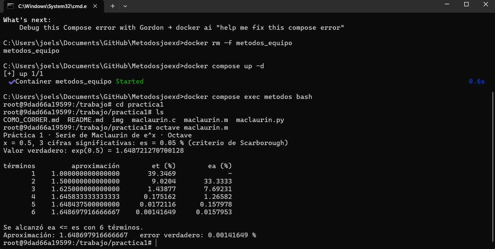
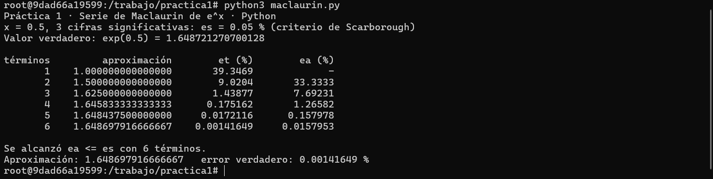
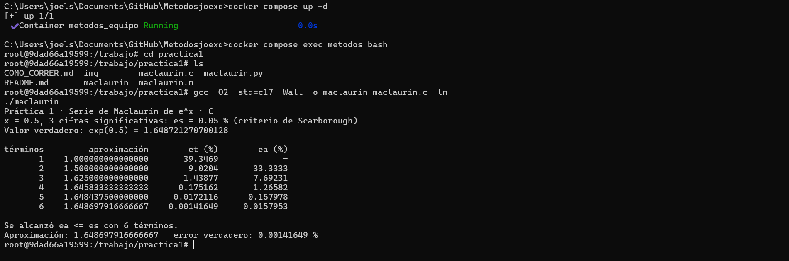

# Práctica 1 · La serie de Maclaurin y el criterio de paro

**UEA 1151039 · Métodos Numéricos en Ingeniería · Trimestre 26-O · UAM Azcapotzalco**
**Profesor:** M. en C. Gabriel Hurtado Avilés

| | |
|---|---|
| Equipo |Individual|
| Integrantes | Joel Sierra Saucedo|
| Matricula | 2253003817|
| Licenciatura | Ingeniería Mecánica |
| Repositorio de la Tarea 1 de |Joel Sierra Saucedo |
| Fecha | 12/10/2026|

## 1. Octave y Python




¿Coinciden con la lámina 25 de la unidad I?

Los resultados obtenidos en los programas de Octave y Python coinciden con los de la lámina 25 de la Unidad I. Las aproximaciones y los errores son iguales, considerando el redondeo de las cifras.
El valor verdadero de \(e^{0.5}\) es 1.648721270700128. El programa alcanza una aproximación de 1.648697916666667 con seis términos.
El error verdadero es de 0.00141649 % y el error aproximado es de 0.0157953 %. Como el error aproximado es menor que la tolerancia de 0.05 %, el programa se detiene en el sexto término.
La lámina también muestra un séptimo término como referencia. Sin embargo, el criterio de paro se cumple desde el sexto término. Por lo tanto, el programa funciona correctamente y no necesita modificaciones.


## 2. Las dos líneas que completamos en `maclaurin.c`

```c
/* COMPLETAR 1 */ termino = termino * X / n;;
/* COMPLETAR 2 */  ea = fabs((aprox - anterior) / aprox) * 100.0;
```



## 3. Más cifras significativas

| Cifras | εs (%) | Términos | Aproximación | Error verdadero (%) 
| -----: | -----: | -------: | ----------------: | ------------------: |
|      3 |   0.05 |        6 | 1.648697916666667 |          0.00141649 |
|      6 |   5e-5 |        9 | 1.648721265035962 |          3.43549e-7 |
|     17 |  5e-16 |       16 | 1.648721270700128 |         2.69354e-14 |


1. ¿Cuántos términos hacen falta en cada caso?

Con 3 cifras se necesitan 6 términos, con 6 cifras se necesitan 9 términos y con 17 cifras se necesitan 16 términos.

3. En cada fila de la tabla, ¿εa es mayor o menor que εt? ¿Por qué conviene detenerse con εa?

El error aproximado es mayor que el error verdadero en los tres casos. Conviene utilizarlo porque no siempre conocemos el valor verdadero de la función y permite establecer cuándo detener el cálculo.

4. Con 17 cifras el programa termina. ¿Cuántas cifras del resultado son correctas en realidad?
   Relaciónenlo con 0.1 + 0.2 de la Tarea 1.

El resultado coincide con el valor de referencia mostrado hasta las cifras impresas. Para determinar cuántas cifras significativas son correctas, se debe comparar la aproximación sin redondear con el valor verdadero y aplicar el criterio de cifras significativas.
## Uso de inteligencia artificial

Utilicé gemini.ia para analizar los datos de los resultados en python, para las 3,6 y 17 cifras y poder completar la tabla del punto 3

## Referencias

Burden, R.L.,& Faires, J.D. (2011). Análisis numérico (9a ed.). Cengage Learning.

Chapra, S.C., & Canale, R.P.(2015). Métodos Numéricos para ingenieros (7a ed.). McGraw-Hill.

